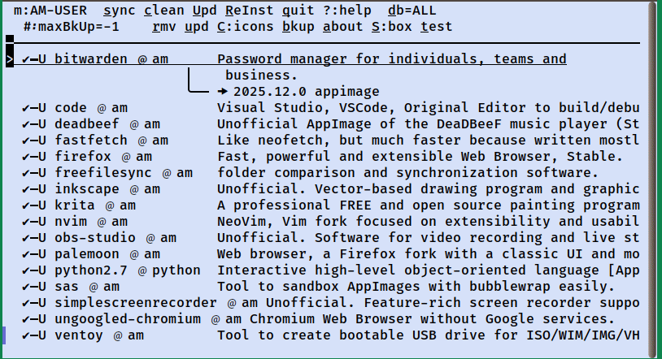

# vappman

`vappman` is a TUI for [`am`/`appman`](https://github.com/ivan-hc/AppMan). Browse 2000+ AppImages, filter them, and see installed vs. available at a glance. Context-sensitive keys walk you through install, test, update, backup, and remove.



## Install

```sh
pipx install vappman
vappman --prereq --doctor   # first run: check the system and prerequisites
vappman                     # normal run
```

`vappman` also offers to install `am`/`appman` (and missing system dependencies) on startup.

## Typical lifecycle

Highlight a row, then act on it. Install and remove prompts stay inline below the row.

1. **Find.** Press `/`, type part of a name or a regex; `ENTER` accepts, `ESC` clears.
2. **Install.** On an available (`◆`) app press `i` or `ENTER`, then choose `n` (plain), `s` (sandbox), `c` (system icons), `b` (both), or `y` (repeat the last choice). `ESC` cancels.
3. **Test (optional).** Press `t` to launch the installed app in a terminal and confirm it runs.
4. **Maintain.** Press `u` to update, `b` to back up, `o` to overwrite from a backup, or `a` for details.
5. **Remove.** Press `r` or `ENTER` on an installed app and confirm with `y`.

Install, remove, backup, icon, and sandbox commands run with `am -y`, so `am` does not ask again.

## Keys

### Highlighted app

| `am`/`appman` | vappman | Works on |
| --- | --- | --- |
| `-i` install | `i` or `ENTER` | highlighted uninstalled app |
| `-r` remove | `r` or `ENTER` | highlighted installed app |
| `-u` update | `u` | highlighted installed app |
| `-b` backup | `b` | highlighted installed app |
| `-o` overwrite from backup | `o` | highlighted installed app |
| `-a` about | `a` | highlighted app |
| `--icons` | `C` | highlighted installed app |
| `--sandbox` / `--disable-sandbox` | `S` | highlighted installed app |
| — (launch) | `t` | highlighted installed app |

### Global / all installed

| `am`/`appman` | vappman | Scope |
| --- | --- | --- |
| `-u` update | `U` | all installed apps |
| reinstall changed scripts | `R` | all installed apps (`am` database) |
| `-c` clean | `c` | unneeded files and directories |
| sync appman itself | `s` | `am`/`appman` |
| `--user` / `--system` | `m` | mode (when using `am`) |
| `-l` list / `-f` files / `-q` search | browse + `/` | whole list |
| — | `d` | database: `ALL`, `am`, `busybox`, `appbundle`, `python`, `soarpkg` |
| — | `#` | backups to keep: `2`, `1`, or `-1` (unlimited) |
| — | `_` / `*` / `T` | header style / demo mode / color theme |
| — | `?` / `q` or `x` | help / quit |

Navigation is standard: arrows, `PgUp`/`PgDn`, `Home`/`End`, mouse wheel, and `j`/`k` or `g`/`G`. `ENTER` is the context action.

### Display

`✔` installed · `🔒` installed and sandboxed · `◆` available · `S` system-wide · `U` user-local · `>` selected. Color is optional; `T` opens the theme picker (`t` cycles, `mono` disables color).

## Filtering

`/` filters as you type. Plain words match in order (`bit fight` → `bitfighter`); regex-like input uses Python syntax (`^vim`, `\bweb\b`). Your selection follows the app, not the row.

## System check

`vappman --doctor` checks `libfuse2`, user namespaces, `/tmp noexec`, AppArmor, and SELinux, with distro-specific fixes. A quick check runs at startup; `--no-startup-check` skips it, and `vappman --help` lists all options.

Anything not covered here (downloads, install templates, version, and so on) is still available through `am`/`appman` directly.
